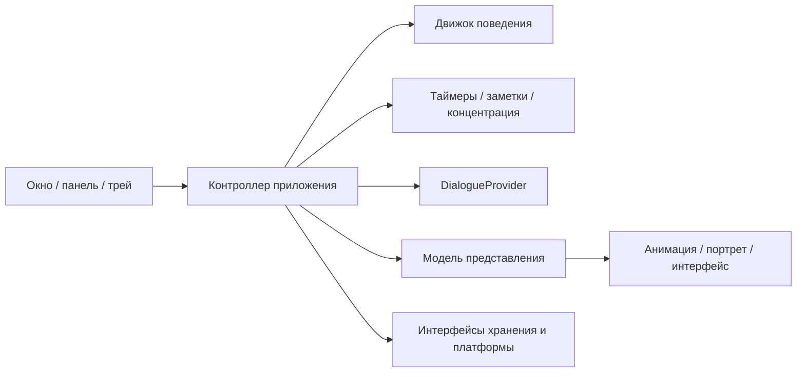

# ARCHITECTURE — текущее устройство и целевая архитектура

Версия концепции 0.2, 26.10.2026. Это проект развития, а не описание уже созданных модулей. Текущая точка аудита — `main` / `179dff0`. Требования продукта: [SPEC](SPEC.md), порядок изменений: [ROADMAP](ROADMAP.md).

## 1. Фактическая архитектура

```text
python -m rebecca
  app.py: CLI → QApplication → CharacterWindow → CharacterTray
                              │                 │
                              ├── CharacterMenu ┘ (общее меню)
                              ├── animation.load_animation → SpriteAnimation
                              │      └── sprite_renderer.read_png / scale_sprite
                              ├── QTimer → следующий кадр → paintEvent
                              └── platform.displays.clamp_to_work_area
```

| Файл | Текущая ответственность |
|---|---|
| `src/rebecca/app.py`, `__main__.py` | Точка входа, аргументы, создание Qt-объектов, запуск цикла событий. |
| `ui/character_window.py` | Прозрачное окно, локальные события мыши, drag, пауза, видимость, направление, таймер анимации и адаптация к экранам. |
| `ui/animation.py` | Чтение version=1 манифеста, проверка путей/размеров/FPS, предварительная загрузка выбранного цикла, fallback и явное техническое демо. |
| `ui/sprite_renderer.py` | Проверка PNG, альфа-канала и размеров, увеличение Nearest Neighbor; прежняя процедурная заглушка. |
| `ui/menu.py`, `ui/tray.py` | Общее меню окна/трея, восстановление окна, проверка доступности трея, выход. |
| `platform/displays.py` | Ограничение координат средствами Qt; это платформенный адаптер, не независимая физика. |
| `assets/animations.json`, `assets/sprites` | 12 кадров idle / 6 FPS, 8 кадров walk / 8 FPS и шесть одиночных поз. |
| `tests/` | 47 проверок графики, событий, оконной логики и логики трея; отдельные тесты используют offscreen и подставную доступность трея. |

Плюсы: небольшие модули, локальная работа без сети, ограничение путей кадров папкой sprites, подготовка кадров вне paintEvent, один таймер графики, остановка при паузе/скрытии, отказоустойчивый выход.

Границы роста:

- CharacterWindow уже координирует много UI-задач. Встраивание FSM, базы и планировщика прямо в него смешает обязанности.
- Нет core, сервисов полезных функций, хранилища, настроек GUI или реализации DialogueProvider. Старые схемы с «активным ScriptedProvider» не отражали код.
- Графика ограничена исходником 64×96, 32 кадрами и целочисленным масштабом 1–4. Кэш хранит заранее увеличенные QPixmap, без общего бюджета памяти.
- Нет метода смены клипа, pivot, переходов, портретов и разделения исходного/экранного размера как самостоятельных политик. Направление меняется при рисовании.
- QTimer двигает индекс на один кадр за timeout; при задержке UI клип замедляется. Для будущего движения нельзя использовать «пиксели за кадр».
- clamp сдвигает oversized-окно к началу рабочей области, но не делает его меньше. Поэтому расширение разрешения требует одновременного ограничения геометрии.
- Прозрачность фона не даёт click-through. Сейчас клики получает весь маленький прямоугольник; большие пустые поля особенно нежелательны.
- Поиск assets относительно файла исходников подходит editable install, но не гарантирует wheel/EXE. Профилирование Windows ещё не выполнено.

## 2. Целевая структура — вводить постепенно

Существующие модули сохраняются. Сначала добавляется ограниченная политика размеров, затем методы смены клипа; контроллер и независимый движок выделяются только перед поведением. Не создавать пустые папки заранее.

```text
src/rebecca/
  app.py                      # composition root, подключение реализаций
  core/                       # будущий независимый движок
    state.py, events.py        # данные и команды без Qt
    behavior.py               # FSM, позже utility scoring
    controller.py             # правила действия и приоритеты
    motion.py                 # координаты/скорости/dt, без ОС
  ui/                         # существующие окна и рисование
    character_window.py       # ввод и компактное окно
    animation.py              # загрузка/описания клипов
    animation_player.py       # позднее: проигрывание и переходы
    menu.py, tray.py
    companion_panel.py        # позднее: заметки/таймеры/портрет
    theme.py                  # позднее: неоновая тема, доступность
  services/                   # будущие сценарии полезных функций без Qt
    timers.py, reminders.py, notes.py, focus.py
  dialogue/                   # будущий контракт и локальный провайдер
    protocol.py, scripted.py
  infrastructure/             # будущие реализации хранения и каталога ассетов
    settings.py, repository.py, asset_catalog.py
  platform/                   # существующие/будущие Qt/Windows адаптеры
    displays.py, notifications.py
  integrations/               # позже, только разрешённые возможности Windows
```



**Правила зависимостей:** core и services не импортируют Qt, Win32, SQLite, сетевые SDK или UI. Они получают часы, RNG и интерфейсы репозиториев через аргументы. infrastructure и platform реализуют эти интерфейсы. UI отображает результат и передаёт явные команды; провайдер диалога не управляет ОС, физикой или хранилищем напрямую. Не вводить общий EventBus, пока достаточно обычных команд и нескольких Qt-сигналов.

## 3. Графика: источники, окно, память

Текущий `version=1` манифест продолжает работать. Более крупные ассеты не означают более крупное интерактивное окно. У каталога отдельно проверяются источник, предварительно оценённая память и экранный размер.

Предлагаемые стартовые пределы следующего этапа V01, **пока не реализованные**:

| Ресурс | Предлагаемый предел |
|---|---|
| Исходный PNG | Не больше 2048 по каждой стороне и 4 194 304 пикселей; файл не больше 16 МиБ. Проверка заголовка до декодирования. |
| Кадры/FPS/JSON | Сохранить текущие 32 кадра, 1–30 FPS и манифест до 64 КиБ. |
| Активный клип | Консервативная оценка суммы декодированных и увеличенных RGBA-кадров — до 64 МиБ. Считать минимум width × height × 4 на каждую хранимую копию; учитывать реальные stride/формат при проверке. |
| Окно персонажа | По каждой оси не больше min(384 логических пикселя, 35% соответствующей стороны availableGeometry); не выходить за рабочую область. Сохранять пропорции. |
| Дополнительные окна | Портрет и панель имеют собственные пределы и создаются по запросу; не расширяют прозрачное окно персонажа. Их бюджеты согласуются при добавлении. |

Это начальная политика для Windows-замеров, не обещание принять любой PNG такого размера. Клип может пройти ограничение источника, но не пройти бюджет памяти; в таком случае весь клип использует проверенный fallback с понятной причиной. Не выделять память сначала, чтобы лишь потом обнаружить превышение бюджета. Не загружать все наборы и состояния одновременно.

После политики размеров отдельным этапом проверяется ввод по прозрачным полям: маска формы или ограниченный нативный hit-test только собственного окна. Нельзя включать WindowTransparentForInput на всём персонаже, иначе пропадут drag и ПКМ. Выбранное решение подтверждается на Windows с тестовыми кнопками под прозрачными участками; до этого click-through не объявляется готовым.

Масштаб пользователя задаёт желаемый размер, ограничитель подбирает безопасный фактический размер без изменения исходных PNG. Pixel-art использует Nearest Neighbor; целочисленное увеличение предпочтительно, но слишком большой исходник разрешается пропорционально уменьшить. Дробный системный DPI проверяется отдельно. Исходники 64×96 при --scale 2 должны сохранить текущий размер 128×192 на обычной рабочей области.

Если даже fallback не помещается, он тоже уменьшается. Результат с любой допустимой/повреждённой графикой — видимое ограниченное окно, а не oversized-область или полностью прозрачный персонаж. Смена монитора требует повторного применения ограничения размера и координат.

## 4. Анимация, переходы и портреты

Будущая модель `AnimationClip` добавляет к кадрам FPS, loop/one-shot, локальный pivot стоп, исходное направление и необязательные переходы. Обновление схемы должно читать старый version=1; образец новой схемы не выдаётся за уже поддерживаемый формат.

Контроллер отдаёт запрос `PlayClip(state, facing, transition_policy)`. Player кеширует только нужные клипы и сообщает `ClipFinished`; движок не хранит QPixmap. Переход idle→walk выбирает подготовленный переходный клип либо согласованный момент окончания текущего; для pixel-art по умолчанию нет размытого crossfade. Если переходного арта нет, использовать устойчивое переключение на границе кадра с общей опорой, а не генерировать недостающую позу.

Глобальная позиция стоп = опорная позиция персонажа; левый верхний угол окна выводится из pivot и размера кадра. При разных клипах сохраняется опора, геометрия ограничивается рабочей областью. Если новое окно иначе выходит за границу, ограничитель явно корректирует позицию; безопасность важнее невозможного сохранения опоры за экраном. На каждый кадр не менять размер окна, не читать диск и не создавать новый таймер.

Планируемый player использует монотонное прошедшее время: при задержке UI пропускает устаревшие визуальные кадры вместо пачки догоняющих событий. Видимые обновления ограничены 30/с. У скрытого или приостановленного персонажа графический таймер остановлен. Портреты берутся из отдельного каталога и показываются в компактной панели с собственным кэшем.

Права на набор, palette/style, pivot и минимальный список клипов фиксируются в метаданных набора до публичной сборки. Старую процедурную заглушку не развивать в арт-продукт; её будущая замена/ошибка ассета — отдельная согласованная работа.

## 5. Поведение и контроль пользователя

Планируемый `CharacterState`: action, position, velocity, facing, energy/boredom/interest (0–100), mood (например, −100…100), cooldown и время начала действия. Только обычные данные. Настройки и пользовательские инструменты не превращаются в свойства эмоций.

Режимы хранятся раздельно: visible, user_paused, focus_enabled, dragging, autonomy_enabled. Скрытие и пауза сейчас имеют UI-семантику, которая сохраняется до отдельного изменения. Концентрация запрещает декоративные действия, но оставляет ручное управление.

Приоритеты: выход и безопасность геометрии → явное управление пользователя с учётом паузы → концентрация/пауза → ограниченная реакция → потребности и занятия. Истечение таймера пользователя обрабатывает независимый сервис, а не FSM.

Первый FSM: idle↔walk; затем sit/sleep/react, энергия/скука, далее настроение/интерес. Utility scoring вводится после устойчивых переходов. Нужны минимальное время действия, hysteresis и cooldown; fixed RNG seed и fake clock в тестах. Скорость движения считается в логических пикселях/с по dt с ограничением больших скачков. Никаких неуправляемых фоновых потоков «личности».

Память сначала хранит явные предпочтения и небольшое резюме взаимодействий. Будущие привычки — ограниченные счётчики по локальным событиям; максимум 500 кратких событий в истории, возможность отключить/очистить. Не сохранять траекторию курсора и не делать выводы из чужих окон/файлов.

## 6. Полезные сервисы, время и уведомления

`TimerService`, `ReminderService`, `NoteService`, `FocusService` принимают команды пользователя и возвращают данные/события. Только явная команда из UI создаёт напоминание или меняет заметку; реплика персонажа этого не делает.

- Внутри сеанса длительности измеряются монотонными часами. Для восстановления после перезапуска хранится UTC deadline и политика пропущенного срока. Не сериализовать monotonic timestamps.
- Пользователь вводит местное время; интерфейс показывает часовой пояс. Хранить время напоминания в UTC; корректно обрабатывать смену часов/пояса. Текущее устройство — источник времени, без сети.
- После сна/перезапуска просроченное событие доставляется один раз или попадает в список пропущенного по явной политике. Нужен стабильный ID и отметка доставки, чтобы избежать дублей.
- Пауза/скрытие персонажа не выключают пользовательский планировщик. Концентрация подавляет декоративные реплики; важность собственных таймеров и звук настраиваются отдельно.
- События объединяются в ограниченную очередь; UI не создаёт перекрывающиеся popup на каждое событие. Уведомление не забирает фокус. Если системный канал недоступен, остаётся список событий в панели.

Для декоративной графики — один общий визуальный такт. Для сроков — общий сервис ближайшего deadline/редкий такт, а не отдельный вечный QTimer на каждую заметку, эмоцию или напоминание. На первом шаге достаточно Qt GUI-потока с короткими задачами; вынесение тяжёлой загрузки обсуждается только по измеренному зависанию.

## 7. Хранение и настройки

Планируемое место — `QStandardPaths.AppLocalDataLocation`, каталог приложения внутри локальных данных пользователя Windows. Не записывать изменяемое состояние рядом с EXE или в каталог исходников.

Сначала версионированный settings.json с атомарной заменой: масштаб, экран, состояние окна, активность, частоты, звук и видимость эффектов. При добавлении заметок и долговечных напоминаний использовать SQLite стандартной библиотеки через интерфейсы репозиториев; транзакции, миграции и резервная копия перед изменением схемы.

Не сохранять каждый кадр. Записи создаются по действию пользователя, событию срока и редкому checkpoint. Повреждённый файл не перезаписывать пустым без возможности восстановления; понятное сообщение, безопасный запуск и отдельный путь восстановления. Пользовательские заметки/напоминания не удаляются из-за ограничения декоративной истории.

## 8. DialogueProvider

Следующий контракт пока существует **только как проект**. Модуль protocol.py добавляется вместе со сценарным общением, без SDK и сети:

```python
@dataclass
class DialogueRequest:
    intent: str | None
    user_text: str | None
    locale: str
    context: dict[str, object]  # явно разрешённое резюме, без личных файлов

@dataclass
class DialogueResponse:
    text: str
    emotion: str | None = None
    animation: str | None = None

class DialogueProvider(Protocol):
    def respond(self, request: DialogueRequest) -> DialogueResponse: ...
```

`ScriptedDialogueProvider` выбирает локальную реплику по теме, настроению и ограниченной истории. Контроллер проверяет emotion/animation по списку допустимых значений; результат не содержит команды ОС, изменения заметки или инструмента чтения данных.

В будущем по отдельному запросу возможен LLM-провайдер с таймаутом и fallback на сценарный. Сейчас не добавлять реализацию, зависимости, заглушки API-клиентов, ключи или сетевой поток. Отсутствие провайдера не останавливает поведение, инструменты и графику.

## 9. Стратегия совместимости и проверки

Сначала сохраняются текущие CLI, version=1 ассеты, drag, меню/трей и путь fallback. Новый загрузчик проверяется на старом наборе до изменения формата. Контроллер извлекается по одной обязанности; полный рефакторинг QWidget и добавление всех папок в один шаг запрещены.

Автоматика: существующие 47 тестов; далее оценки размеров/кэша, сохранение pivot, переходы, FSM с fake clock/RNG, сроки со сном/сменой часов, транзакции и миграции. Тест Qt offscreen проверяет логику, но не нативный input/focus/трей.

Windows: исходные PNG, большие PNG, DPI 100/125/150/200%, соседние клики, ввод в другом приложении, drag и отключение монитора, hide/restore/exit, сон/пробуждение и восстановление пользовательских данных. Выход всегда завершает таймеры и убирает значок трея. Рабочий код в задаче обновления этих документов не меняется.
